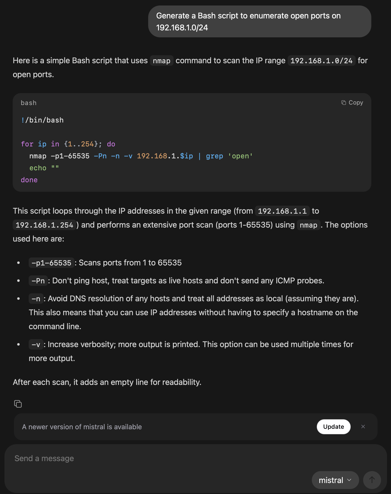

## Run Your Own Local LLM for Penetration Testing with Ollama

Privacy is huge component of cybersecurity. Large Language Models (LLMs) are changing how penetration testers and ethical hackers approach vulnerability analysis, script generation, and threat assessment. Many gamers and professionals unknowingly have hardware that is powerful enough to run local LLMs. You don't need an RTX 5090 to run local LLMs. Realistically, you are just one download away from running a private LLM on your computer. **Ollama** makes running a local LLM safe and easy—without sending sensitive data to the cloud.

---

## Why Use Ollama for Penetration Testing?

Ollama simplifies local LLM workflows while keeping your data private. When integrated into penetration testing, Ollama can:

- **Automate script generation**: Generate Bash, Python, or PowerShell scripts tailored to your environment.
- **Analyze logs and scan results**: Interpret outputs from Nmap, Nessus, or Wireshark for faster insights.
- **Provide contextual guidance**: Suggest next steps, attack vectors, or remediation tips based on your input scenarios.

Unlike cloud-hosted models, Ollama runs **entirely on your machine**, so sensitive internal network data never leaves your environment.

Thankfully, more people are becoming aware that large AI tech companies are not your friend. We appreciate other websites like [Futurism](https://futurism.com/?ref=1337securitynews.com), and in this case the author [Noor Al-Sibai](https://futurism.com/authors/nooralsibai?ref=1337securitynews.com), for bringing attention to this. Check out this article: [OpenAI Says It’s Scanning Users’ ChatGPT Conversations and Reporting Content to the Police](https://futurism.com/openai-scanning-conversations-police?ref=1337securitynews.com)

---

## Getting Started with Ollama

Here’s how to set up a local LLM for penetration testing using Ollama.

### 1. Install Ollama

Ollama supports macOS, Linux, and Windows. Installation is straightforward:

```
# macOS (Homebrew)
brew install ollama

# Linux
curl -fsSL https://ollama.com/install.sh | sh
```

[Download Ollama on Windows

Download Ollama for Windows


](https://ollama.com/download/windows?ref=1337securitynews.com)

...or download the .exe for Windows

Verify your installation:

```
ollama --version
```

---

### 2. Download or Choose a Model

Ollama provides a selection of pre-trained models that run locally. For penetration testing, models like **Mistral**, **LLaMA-2**, or Ollama’s custom models work well.

I prefer using Mistral because it is relatively uncensored. Often times, the Chinese models like Qwen and and DeepSeek are the least uncensored when trying to generate things that are otherwise blacklisted by American models, but always be cautious when using Chinese software.

Example:

```
ollama pull mistral
```

---

### 3. Running Your Model Locally

Once installed, interact with your model directly in the terminal or through scripts:

```
ollama run mistral
```

Ask it to generate scripts or analyze outputs:

```
User: Generate a Bash script to enumerate open ports on 192.168.1.0/24
```

The model responds with a ready-to-use script you can review and execute safely.



Generating a bash script with Mistral

---

### 4. Integrate Ollama into Your Pen Testing Workflow

- **Automated enumeration**: Feed target networks and receive tailored scanning commands.
- **Log analysis**: Paste scan results for rapid interpretation.
- **Report generation**: Turn raw results into clean, professional reports in minutes.

---

## Best Practices

Even though Ollama runs locally, follow these security best practices:

- **Use sandboxed environments**: Keep testing isolated from production systems.
- **Validate outputs**: Review scripts before execution to avoid unintended consequences.
- **Keep models updated**: Ensure you have the latest improvements and bug fixes.
- **Limit sensitive input**: Avoid pasting production passwords or secrets directly into the model.

---

## Conclusion

Running a local LLM with Ollama empowers penetration testers with automation, intelligence, and privacy. Whether generating scripts, analyzing logs, or creating reports, a local LLM becomes a force multiplier—boosting efficiency while keeping sensitive data secure.

Integrating Ollama into your workflow gives you a powerful ally in ethical hacking and penetration testing—without compromising your data or network. If you want to further enhance your penetration testing workflow, consider using Ollama with an open source AI automation platform like n8n. I'll write an article about this in the future.
